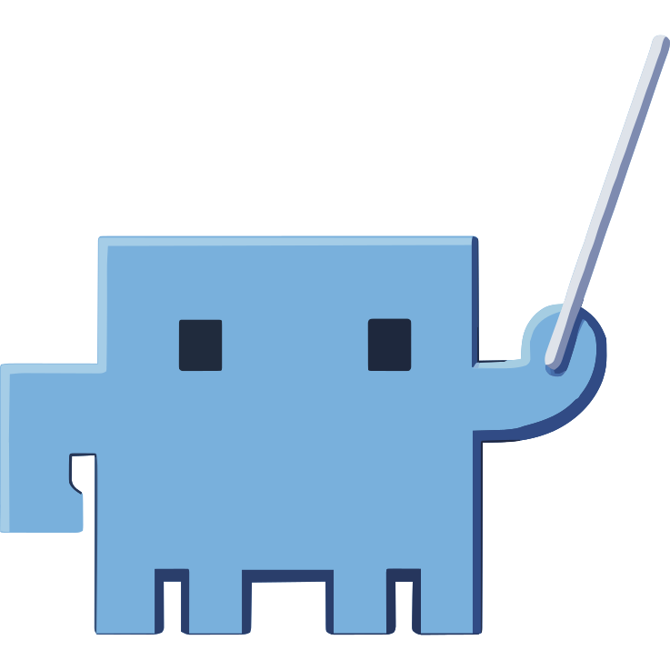

<div align="center">
  

# Tallpine

**Plan, run, and supervise coding agents from one place.**

A hard fork of [Agent Orchestrator](https://github.com/OrchestratorInc/agent-orchestrator) that installs and runs **side by side** with the official app.

[](LICENSE)
[](https://github.com/justvibedev/tallpine/releases/latest)
</div>

## What it is

Tallpine is a local desktop workspace for running several coding agents across a project. Add a repository and create a worker session with the agent, model, and interface that fit the task. Every Git-backed worker gets its own branch and worktree. A local daemon watches agent activity, pull requests, CI, and review state and shows all of it on a live Kanban board. A project-aware orchestrator agent can plan larger outcomes and spawn or redirect workers.

It is a fork of [OrchestratorInc/agent-orchestrator](https://github.com/OrchestratorInc/agent-orchestrator) (Apache-2.0), which is the source of nearly all of the code, design, and documentation. All credit for the original product belongs to its authors. This fork is not affiliated with or endorsed by OrchestratorInc. See [`NOTICE`](NOTICE) and [`LICENSE`](LICENSE).

## Runs beside the official install

Everything that could collide with an official Agent Orchestrator install on the same machine has its own identity, defined in one place per side (`backend/internal/brand/brand.go` and `frontend/src/shared/brand.ts`):

| Thing | Official AO | Tallpine |
| --- | --- | --- |
| Product name | Agent Orchestrator | Tallpine |
| CLI binary | `ao` | `tallpine` (no `ao` alias) |
| Bundle / app id | `dev.agent-orchestrator.desktop` | `ee.justdev.tallpine` |
| State root | `~/.ao` | `~/.tallpine` (Electron `userData` is `~/.tallpine/electron`) |
| Env overrides | `AO_DATA_DIR`, `AO_RUN_FILE`, `AO_PORT`, ... | `TALLPINE_DATA_DIR`, `TALLPINE_RUN_FILE`, `TALLPINE_PORT`, ... |
| Daemon port | `3001` | `3101` |
| Desktop URL scheme | `ao-app://` | `tallpine://` |
| In-app links | `ao://sessions/...` | `tallpine://sessions/...` |
| tmux socket | `ao` | `tallpine` |
| launchd labels | `com.aoagents.*` | `ee.justdev.tallpine.*` |
| MCP server / skill | `ao` / `using-ao` | `tallpine` / `using-tallpine` |
| Agent hooks | `ao hooks <agent> <event>` | `tallpine hooks <agent> <event>` |

The hook installers write only `tallpine hooks ...` entries and never modify or remove the official `ao hooks` entries.

**Environment variables.** The whole `AO_*` prefix was renamed to `TALLPINE_*` (the old `VO_*` names are still read as a fallback), including the agent-session variables such as `TALLPINE_SESSION_ID`, `TALLPINE_PROJECT_ID`, and `TALLPINE_RUN_FILE`. That keeps a Tallpine-spawned agent from being mistaken for an official AO session (and the other way round). The cost is a larger diff against upstream; it was a mechanical rename.

**Compatibility.** Tallpine writes the per-repository `.tallpine/launch.json` and `.tallpine/attachments/`, and still reads the older `.ao/launch.json` and `.ao/attachments/` as a fallback. Persisted and on-wire names (the `ao.db` file name, `ao_*` JSON/database keys, `X-AO-*` headers, `_ao/*` ACP methods, the `ao-handoff-request` marker, the `AOImport*` API schemas) are unchanged so existing data and installed clients keep working. Generated session branches use `tp/<session-id>/root`; existing `ao/...` branches keep working.

## Changes from upstream

- **Removed:** all telemetry, analytics, and crash reporting.
- **Removed:** the hosted cloud integration, WorkOS sign-in, and the GitHub App.
- **Changed:** the upstream auto-updater, update telemetry and version-floor infrastructure are gone. The macOS app updates itself from signed, notarized GitHub Releases on `justvibedev/tallpine` only (on by default; Settings, General, Updates; MDM keys in [docs/agent-policy.md](docs/agent-policy.md#desktop-app-updates)). Dev and local builds never auto-update.
- **Removed:** the legacy TypeScript-AO import feature.
- **Security:** a per-install daemon token on the loopback listener (`daemon.token`, header `X-VO-Token`) and a localhost `Host` allowlist.
- **Reports:** per-project report delivery fix (one orphaned project can no longer stall the others) and automatic `turn_ended` / `exited` notifications for workers.
- **Harnesses:** limited to `claude-code`, `codex`, and `kiro`.
- **Review:** the native reviewer receives the task intent (as untrusted context).
- **Projects:** a prompt-only `verifyCommand`; `done` reports without evidence are soft-verified (annotated as unverified).
- **Workspaces:** `.worktreeinclude` seeds ignored files into new worktrees, with APFS `clonefile` seeding for large directories; workspace observation reports a read-only `merged` flag.
- **Chat:** right-click on local file paths in chat to reveal, open, or copy them.
- **CLI fixes:** `tallpine pr merge` resolves the PR URL and head SHA, `tallpine project set-config` merges flags into the existing config, `tallpine send` reports the delivery outcome, spawn/tmux timeouts are configurable and a timed-out create cleans up its runtime, and the stored origin URL refreshes from the git remote.

## Install and quickstart

Installation, first-run setup, and usage guides are at **<https://docs.tallpine.eu>**. Contributor setup is in [CONTRIBUTING.md](CONTRIBUTING.md) and [`docs/development.md`](docs/development.md); security reports go through [SECURITY.md](SECURITY.md).

## Build from source

Prerequisites: macOS (Apple silicon or Intel), Git, Go (see `backend/go.mod`), and Node.js 22 with npm.

```bash
git clone https://github.com/justvibedev/tallpine.git
cd tallpine

# CLI + daemon only
cd backend
go build -o ./bin/tallpine ./cmd/tallpine
./bin/tallpine --help
./bin/tallpine daemon          # daemon on ~/.tallpine/sock/daemon.sock (TALLPINE_LOOPBACK_TCP=1 adds 127.0.0.1:3101)

# Desktop app (builds the daemon, tmux, browser runtime, then packages)
cd ../frontend
npm ci
npm run package          # macOS unsigned: TALLPINE_ALLOW_UNSIGNED=1 npm run package
                         # -> out/Tallpine-<platform>-<arch>/Tallpine.app
npm run make             # installers (dmg / zip on macOS; unsigned: TALLPINE_ALLOW_UNSIGNED=1 npm run make)
```

For development, `cd frontend && npm run dev` starts the Electron app against a dev daemon, with its own `~/.tallpine/dev` state.

Move `Tallpine.app` to `/Applications`. It can sit next to `Agent Orchestrator.app` because the bundle name, bundle id, `userData`, data directory, port, and URL scheme all differ. To put `tallpine` on your `PATH`, enable Developer mode and use the global `tallpine` command link in Settings (it also links `tp`, and a deprecated pre-rename alias), or symlink the bundled daemon binary yourself.

### Local macOS build

```bash
cd frontend
npm ci
npm run package -- --arch arm64      # macOS unsigned: prefix TALLPINE_ALLOW_UNSIGNED=1; use `npm run package`, not `electron-forge package`:
                                     # only the npm script runs the prepackage steps
                                     # (daemon, tmux, browser runtime, cloudflared)
rm -rf ~/Applications/"Tallpine.app"
cp -R "out/Tallpine-darwin-arm64/Tallpine.app" ~/Applications/
```

When no `APPLE_SIGNING_IDENTITY` / `CSC_LINK` is set, the packaging step re-signs the bundle ad hoc (`codesign --force --deep -s -`) so its signature identifier matches the bundle id `ee.justdev.tallpine` instead of Electron's stock `com.github.Electron`. Check with `codesign -dv "Tallpine.app" 2>&1 | grep Identifier`.

Quit (menu, Cmd-Q, Dock, `osascript -e 'quit app id "ee.justdev.tallpine"'`, SIGTERM) exits the app, removes the menu-bar icon, and stops the daemon it started. Closing the window keeps Tallpine resident in the menu bar. Sessions survive either way.

Unsigned local builds are fine for personal use, but on macOS packaging refuses to build one unless you opt in explicitly: `TALLPINE_ALLOW_UNSIGNED=1 npm run package` (Linux and Windows are unaffected). To sign and notarize, set `APPLE_SIGNING_IDENTITY` and `TALLPINE_NOTARY_PROFILE` (or the App Store Connect API key variables) before `npm run make`.

GitHub Actions are disabled on this repository. Run the checks locally:

```bash
npm run lint                  # backend go test ./... + golangci-lint
npm run frontend:typecheck    # tsc --noEmit
cd frontend && npm test       # vitest
```

## Documentation

How Tallpine plans before it builds is described in [`docs/planning.md`](docs/planning.md). Architecture, CLI, daemon, and harness notes live in [`docs/`](docs/README.md) (start with [`docs/architecture.md`](docs/architecture.md) and [`docs/development.md`](docs/development.md)). Repository rules for contributors and coding agents are in [`AGENTS.md`](AGENTS.md) and [`CLAUDE.md`](CLAUDE.md). Much of the in-app documentation still describes upstream behavior and branding and is being updated gradually.

## License

Apache License 2.0. See [`LICENSE`](LICENSE) and [`NOTICE`](NOTICE). Tallpine is a fork of [Agent Orchestrator](https://github.com/OrchestratorInc/agent-orchestrator) by OrchestratorInc and contains modifications to it.
