# Planning before building

Tallpine can plan an item before anyone builds it. A read-only **planner** agent reads the code, works out the context and how to deliver the change, and flags risks before anything is built. It asks you only what the code can't answer (each question with a recommended answer) and lists its assumptions, then writes a plan with its risks. You approve the plan, and only then does an implementer build it. The reviewer later checks the code against the decisions you made.

## Why

In a controlled benchmark, workflows that collected the owner's real decisions before building passed far more hidden tests than workflows that did not, including one where a strong model planned alone. A plan that never went through the owner mostly hard-codes a guess, and a reviewer cannot catch a wrong feature without knowing the requirements.

## When Tallpine plans

Each project has a planning mode (Settings, Project, or `planningMode` in the project config); a project that sets none follows the app default in Settings > Reviews:

| Mode | Behaviour |
| --- | --- |
| `auto` (default; empty means auto) | The orchestrator decides. It plans only work that splits into several PRs; single-PR work (including schema or migration, cross-area or ambiguous items) goes straight to a worker that asks its questions in its report, and trivial fixes are never planned. Say "plan this" or "just do it" to override it for an item. |
| `always` | Every item is planned. Starting work on an item without an approved plan is refused; use `tallpine plan start <ref>`, or `--force` to skip. "Just do it" still skips one item. |
| `off` | Nothing is planned unless you ask ("plan this"). |

## The flow

An item has at most one open plan. If the planner has no questions or assumptions, it goes straight to writing.

| Status | Meaning |
| --- | --- |
| `drafting` | The planner is exploring the repository. |
| `awaiting_answers` | Waiting for you to answer the questions and check the assumptions. |
| `writing` | The planner is writing the plan. |
| `awaiting_approval` | The plan is ready for you to approve. |
| `approved` | You approved it; implementers can build. |
| `superseded` | Replaced by a re-plan, or the item was closed. |
| `failed` | The planner ended without submitting a plan. |

*Stale* is not a status: it is a warning on an approved plan (see below).

## The plan card

The owner's surface is the plan card in the desktop app (backlog item and project conversation). It shows each question as options with the recommended one preselected plus **Other**, the assumptions (accepted unless you correct them), and buttons to answer, go with the defaults, approve or re-plan. There are at most 5 questions, each with a recommended answer, and up to 20 assumptions. Nothing times out and nothing answers for you.

### On your phone

The mobile app shows the same card for plans that wait on you: answer, correct assumptions, **Go with defaults**, and **Approve plan**. A failed plan is view-only on the phone; re-plan from the desktop.

The plan is the item's stored record: Markdown, a decisions table, a PR split and a few review-focus lines. Your orchestrator can relay your answers from chat, but an approval needs your message in the project conversation, after the plan last changed.

## After approval

- **Several PRs.** A split of two or more PRs creates child items, one per PR, with the PR's tests as its done-when and each blocked by the one before. A one-PR plan creates none.
- **Implementer.** It is told to build from the decisions table and to report any departure at once as a `Deviation:` checkpoint.
- **Reviewer.** It checks the code against the decisions and the review focus and flags unreported departures.

## Stale plans and re-planning

If the default branch has moved since the plan was made and touched a path the plan names, the approved plan is flagged **stale**. The check is advisory. The item card also flags an item edited after planning began.

Choose **Re-plan** (`tallpine plan replan <ref>`) to plan again, or **Build anyway** (`tallpine plan build-anyway <ref>`) to keep the plan. On re-plan, unstarted children are dropped, while done and already-started children are kept and the new planner plans only the remaining work.

## Backlog runs

A backlog run asks for a plan for each item that needs one. Such an item waits as needs-you until its own plan is approved, then queues like any other item.

## Which agent plans

The project's `planner` override, else its orchestrator, else its worker; it never defaults to a vendor or to the strongest model. See [agent-policy.md](agent-policy.md#planner-planner).

## Test projects: auto-approve

`planAutoApprove` is off by default and approves each submitted plan at once, which is meant for unattended test and benchmark projects. A project that sets none follows the app default (Settings > Reviews, off unless you turn it on); `--plan-auto-approve[=false]` sets the project's own value and `--plan-auto-approve-inherit` clears it. Only a person can set either (Settings or `tallpine project set-config <id>`); agents are refused.

## Managed policy (MDM)

Administrators can pin planning for every project with the `planner` agent-policy rule. All fields are empty by default and an empty field locks nothing. The rule and a managed-file example are in the [planner section of agent-policy.md](agent-policy.md#planner-planner).

| Key | Values | Effect |
| --- | --- | --- |
| `planner.mode` | `off`, `auto`, `always` | Overrides every project's `planningMode` and the app default. Managed file or environment only. |
| `planner.harness` | string | Pins the planner's harness; set it with `model`. |
| `planner.model` | string | Pins the planner's model. |
| `planner.autoApprove` | `off` | Locks `planAutoApprove` off in every project (an invalid value does too). Managed file or environment only. |

## CLI

`tallpine plan` subcommands take an item ref (such as `B12`) and most accept `--project` and `--json`.

| Command | Who | What |
| --- | --- | --- |
| `show <ref>` | anyone | Status, questions, answers, decisions and the plan. |
| `start <ref>` | orchestrator, owner | Start a planner ("Plan now"). |
| `answer <ref> --file answers.json [--relayed]` | owner | Answer questions and correct assumptions. |
| `defaults <ref> [--relayed]` | owner | Take every recommended answer and assumption. |
| `approve <ref> [--owner-message <id>\|last]` | owner | Approve. An agent must cite your chat message. |
| `replan <ref>` | owner, orchestrator | Supersede the plan and plan again. |
| `cancel <ref>` | owner, orchestrator | Drop the plan that waits on the owner and stop its planner; the item stays open to plan again. |
| `build-anyway <ref> [--owner-message <id>\|last]` | owner | Build from a stale plan. |

## Plan in place (`planInPlace`)

Project setting `planInPlace` (default off; a person sets it with `tallpine project set-config <id> --plan-in-place`, and so may the orchestrator of the project that registered it (never a project's own orchestrator); a managed `planner.inPlace` of `off` locks it off). With it on, `tallpine spawn --backlog <ref>` on an item that needs a plan starts an implementer that writes the plan itself instead of refusing with `PLAN_REQUIRED`. It uses the same plan record, questions, card and approval as a separate planner, and waits read-only: the daemon refuses its questions or plan once it has a PR, and refuses a review trigger (`PLAN_NOT_APPROVED`) until the plan is approved. Approval is a message to that implementer; on a split it builds PR 1 (linked to child 1) and the orchestrator spawns the rest. `--plan in-place|separate` forces a side per spawn. A project marked `eval` (config `eval: true`, set by the user or the orchestrator that registered it) lets that orchestrator drive its backlog, plans and sessions from its own project and approve plans without an owner chat message, for throwaway evaluation runs; real projects keep the owner-message guard. A managed `planner.autoApprove` of `off` also removes the approval waiver (an eval project then needs the owner's message like any other), while the eval scope routes stay open. `plan start` and backlog runs keep separate planners. Replan never kills the implementer; it is asked to plan again.
